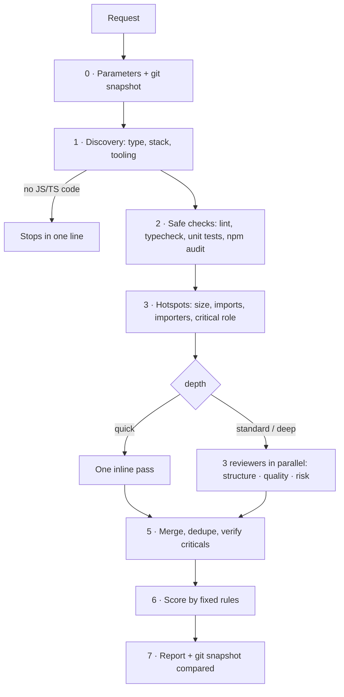

# tech-audit — usage

A read-only technical audit of a JavaScript/TypeScript repository as it stands. It works out what the
project is, runs the project's own safe checks, finds the files where risk concentrates, inspects the
code through three lenses, and reports a few prioritized findings, each pointing at evidence, with a
scorecard computed from fixed rules.

It never changes the repository: no fixes, installs, builds or formatting.

## When to use it

- You inherit or evaluate a repository and want to know where its real risks are, with evidence.
- You want a baseline before a release, a refactor or a scale-up, and a Now / Next / Later roadmap.
- You want areas it could not measure marked as such, not estimated.

## When not to

- Reviewing a diff, a branch or a PR: use the review skills (`standard-code-review`, `4r-review`).
- A question about a single file: just ask it.
- You want the problems fixed: the audit only recommends. Ask for the fix afterwards, separately.
- The repository has no JS/TS code: it stops in one line and says what it found instead.

## How to invoke

By name (`tech-audit`) or by asking for it: "auditoría técnica de este repo", "audit this project".
When you ask about the overall health of a JS/TS repo without naming it, it may suggest itself once.

Plain invocation with nothing else audits the whole repository at `standard` depth with general
focus. Add any of these in your own words:

| Say | Parameter | Effect |
|---|---|---|
| "rápido", "triage" | `depth: quick` | no commands run, 5 hotspots, ≤10 files read, ≤8 findings; a few minutes |
| — (default) | `depth: standard` | runs the safe checks, 10 hotspots, 3 parallel reviewers, ≤30 files, ≤12 findings |
| "a fondo", "deep" | `depth: deep` | 20 hotspots, ≤60 files, ≤15 findings, cycle tool if installed, *Evolution risks* section |
| "antes de salir a producción" | `focus: release` | weighs Reliability, Engineering Quality and Security more |
| "mantenibilidad", "escalabilidad", "deuda técnica" | `focus` | weighs and reads first the areas of that focus |
| "estricto" | `change_tolerance: strict` | half-done migrations and failing checks count as active debt |
| "es un backend", "es una librería" | `project_type` | overrides detection; a disagreement is noted |
| "auditá `packages/api`" | target path | audits only that folder as the package root |
| "solo `src/`", "sin `legacy/`" | `include_paths` / `exclude_paths` | narrows what is analyzed |
| "en 10 minutos" | `max_runtime` | cuts command execution first, then reading; the cut is reported |

## What happens after you ask



- **Safe checks** run only when they are clearly read-only: each script is read first, along with the
  scripts it calls and its `pre`/`post` hooks. Anything that could write, build, touch a database or
  start services is skipped and listed in *Analysis Limits*. Nothing is ever installed; without
  `node_modules`, checks are recorded as not executed.
- **Reviewers** each own some dimensions, so nothing is penalized twice:

  | Lens | Dimensions |
  |---|---|
  | structure | Architecture, Maintainability |
  | quality | Reliability, Engineering Quality, Performance, Frontend Quality |
  | risk | Security, Operability & Documentation |

  Each one gets a checklist adapted to the project type (frontend, backend, CLI, fullstack, library,
  static) and a hard cap on files read.
- **Scoring** comes after the findings, never before. Each area lands in a band chosen by counting
  its findings, weights depend on the project type and focus, and a confirmed critical caps the
  global score at 5.9. Areas without evidence (e.g. Performance with no measurements) show `—`
  instead of a guess, and the global score says what it excludes.
- **No-write check**: `git status` is taken before and after; any difference is reported.

## What you'll be asked

Nothing before or during the audit. One line at the end offers to save the report to a file at a path
you choose; it writes only if you say yes with a path.

## What you get

Six sections, in your language: **Executive Summary** (score, verdict, confidence, main risks),
**Scorecard** (one row per area), **Prioritized Findings** (severity, evidence `path:line`, observed vs
inferred, impact, action, effort), **Strengths**, **Recommended Actions** (Now / Next / Later, by
finding id) and **Analysis Limits** (what was not run or not read, and why).

| Score | Verdict |
|---|---|
| 9.0–10 | Excellent |
| 8.0–8.9 | Solid |
| 7.0–7.9 | Good |
| 6.0–6.9 | Acceptable |
| 5.0–5.9 | Fragile |
| < 5.0 | High risk |

*Confidence* is how much support the score has, not how good the project is. `quick` runs no checks,
so it tops out at Medium.

## Minimal example

> "tech-audit de `scripts/installer`" (abridged)

```
## Tech Audit — scripts/installer
backend (cli) · depth standard · focus general · tolerance flexible · ref 08bbb3a

### Executive Summary
**Score:** 7.6/10 — Good
**Confidence:** Medium

A small, dependency-free CLI with a working test suite; the risk sits in the uninstall path and an
untested main flow.

Main risks:
- uninstall removes paths read from the manifest without checking they stay in the target (SEC-001)
- the main install flow has no tests (REL-001)

No critical findings.

### Scorecard
| Area | Score | Confidence | Main signal |
|---|---:|---|---|
| Architecture | 8.0 | High | clear split between core and commands |
| Reliability | 6.0 | High | core/flow.js untested |
| Security | 6.0 | High | manifest paths not contained |
| …

### Prioritized Findings
#### HIGH · SEC-001 · Uninstall deletes manifest paths without containment
**Evidence:** `core/flow.js:236`, `core/manifest.js`
…

### Recommended Actions
**Now**
- Check every manifest path resolves inside the target before deleting (SEC-001) · Low
…

### Analysis Limits
- `git status` identical before and after; writes into ignored caches cannot be ruled out
- security was a static, non-exhaustive review; dependency audit not needed (no dependencies)
- 11 of 13 source files read in detail

¿Querés que guarde este reporte en un archivo? Decime la ruta.
```

---

For the exact rules (project-type tests, command vetting, bands, weights, report template), see
[SKILL.md](./SKILL.md) and the files in [references/](./references/).
